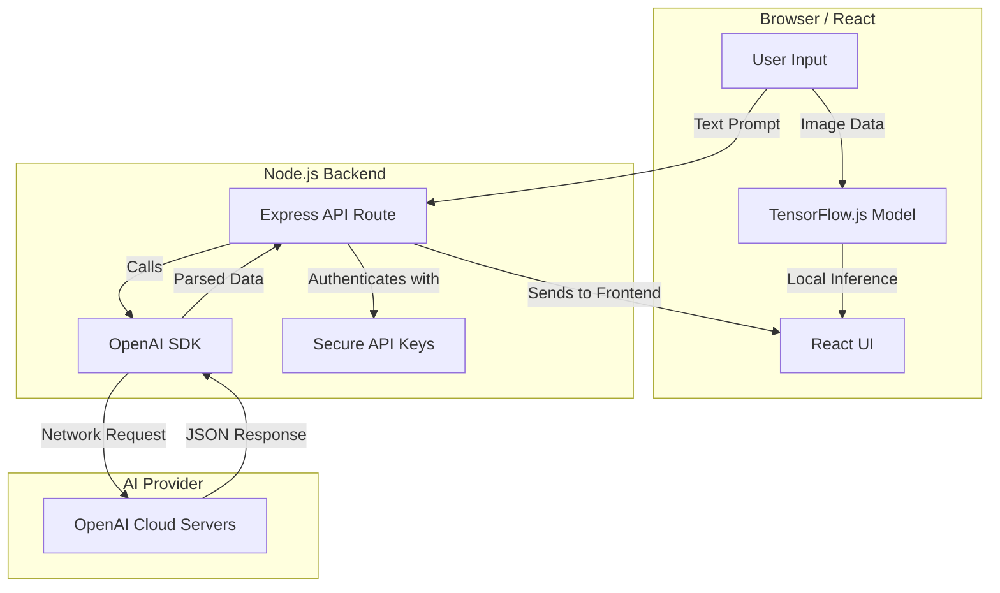

USING PRE-TRAINED MODELS AND SDKs

**Session Time:** 120 minutes

---

## Table of Contents

1. Core Concepts: Pre-Trained Models vs. Custom Models
2. The "Model as a Service" Paradigm
3. APIs vs. SDKs: Why use a Library?
4. Implementing Language Features (OpenAI SDK)
5. Implementing Vision Features (TensorFlow.js Pre-trained Models)
6. Lab: Adding AI Sentiment Analysis
7. Wrap-Up and Reflection
8. Resources

---

## Module Overview

In this module, learners leverage pre-trained AI services and SDKs to implement language, vision, and recommendation features. Instead of training models from scratch (which requires massive data and compute), we focus on integrating "off-the-shelf" intelligence that is ready to use immediately.

---

## Learning Objectives

By the end of this module, participants will be able to:

1. **Implement AI functionality** using pre-trained SDKs and APIs to enhance web features.
2. **Differentiate** between raw API calls and SDK methods, understanding the benefits of using official libraries.
3. **Integrate** specific capabilities such as text generation (sentiment analysis) and computer vision (object detection) into an existing web codebase.

---

## Session Breakdown

| Segment | Topic | Duration (minutes) |
| --- | --- | --- |
| 1 | The "Model as a Service" Paradigm | 20 |
| 2 | APIs vs. SDKs: Why use a Library? | 20 |
| 3 | Implementing Language Features (OpenAI) | 25 |
| 4 | Implementing Vision Features (TensorFlow.js) | 25 |
| 5 | Lab: Adding AI Sentiment Analysis | 30 |

---

## 1. Core Concepts: Pre-Trained Models vs. Custom Models
One of the most important decisions you will make is evaluating business problems to correctly classify them and choose the appropriate modern solution, such as Classic ML, Pre-trained AI, or a Custom Model. 

* **Custom Models:** 
  <br>Require you to define the problem, collect data, perform exploratory data analysis, engineer features, and train the model. This is time-consuming and requires specialized data science skills.

* **Pre-Trained Models:** 
  <br>These are heavy Machine Learning models (like GPT-4) hosted by external services that have already been trained on vast amounts of data. Instead of training them, you simply interact with them via an API or an SDK (Software Development Kit).

---

## 2. The "Model as a Service" Paradigm

Building a machine learning model from scratch involves data collection, cleaning, training, tuning, and deployment. "Model as a Service" (MaaS) abstracts this entire process. You simply send input to a provider, and they return the output.

### Advantages of Pre-trained Models

* **Time to Market:** Add "Computer Vision" to your app in 15 minutes instead of 6 months.
* **Performance:** Models like GPT-4 or MobileNet have been trained on datasets larger than most individual developers can access.
* **Maintenance:** The provider handles updates and scaling.

---

## 3. APIs vs. SDKs: Why use a Library?

An SDK (Software Development Kit) is a wrapper provided by the AI company that makes writing code to connect to their API much easier. Instead of manually formatting HTTP request headers and body payloads using `fetch`, you call built-in functions provided by the SDK. 

There are generally two ways to use pre-trained models in web apps:
1. **Server-Side APIs (e.g., OpenAI API):** The model is too large for the browser, so it runs on a remote server.
2. **Client-Side Libraries (e.g., TensorFlow.js):** The model is optimized and downloaded directly into the user's browser, running locally without needing a backend.

### What is an SDK?

An SDK is a library of code (a "kit") provided by the service to help developers use their API more easily. It acts as a wrapper around the raw API calls.

### Comparison: Raw Fetch vs. OpenAI SDK

**Approach A: Raw Fetch (Harder)**

```javascript
const response = await fetch("https://api.openai.com/v1/chat/completions", {
  method: "POST",
  headers: {
    "Authorization": `Bearer ${apiKey}`,
    "Content-Type": "application/json"
  },
  body: JSON.stringify({ model: "gpt-3.5-turbo", messages: [...] })
});
// You must manually handle errors, retries, and JSON parsing.

```

**Approach B: Using the SDK (Easier)**

```javascript
import OpenAI from 'openai';
const openai = new OpenAI();

const completion = await openai.chat.completions.create({
  messages: [{ role: "user", content: "Hello" }],
  model: "gpt-3.5-turbo",
});
// The SDK handles headers, types, and connection errors for you.

```


---

## 4. Server-Side SDK (OpenAI API for Language)
When using the OpenAI SDK, the Node.js server acts as the secure middleware. It is crucial that the Node.js server holds the secret API keys (e.g., `OPENAI_API_KEY`) because storing these keys on the client-side (React) allows them to be stolen by inspecting the browser code.

```javascript
// Server-side Node.js Example using the OpenAI SDK
import OpenAI from 'openai';

// The SDK automatically looks for the OPENAI_API_KEY in your environment variables
const openai = new OpenAI(); 

app.post('/api/summarize', async (req, res) => {
  const { text } = req.body;
  
  try {
    // Using the SDK's built-in methods instead of a raw fetch request
    const completion = await openai.chat.completions.create({
      model: "gpt-4",
      messages: [{ role: "user", content: `Summarize this: ${text}` }],
    });
    
    // The response is already parsed nicely by the SDK
    res.json({ summary: completion.choices[0].message.content });
  } catch (error) {
    res.status(500).json({ error: "AI Service Unavailable" });
  }
});

```

---

## 5. Client-Side SDK (TensorFlow.js for Vision)

Unlike OpenAI, TensorFlow.js allows you to load small, pre-trained models directly into the browser. This means no API keys are required, and the processing happens on the user's device (zero latency from network calls).

```javascript
// Client-side React Example using TensorFlow.js (Coco SSD for object detection)
import '@tensorflow/tfjs';
import * as cocoSsd from '@tensorflow-models/coco-ssd';

async function detectObjects(imageElement) {
  // Load the pre-trained vision model directly in the browser
  const model = await cocoSsd.load();
  
  // Run inference on an HTML image element
  const predictions = await model.detect(imageElement);
  
  console.log("Detected objects:", predictions);
  // Example output: [{ class: "cat", score: 0.98, bbox: [...] }]
}

```

---

## 6. Architectural Flow of SDK Integration

> Depending on the tool you use, the architecture of your AI application changes significantly.



---

## 7. Lab: Adding AI Sentiment Features

**Objective:** Use the OpenAI Node.js SDK to build a backend text-summarization route, and use TensorFlow.js to build a frontend image-classification component.

**Refer**: [**Adding AI Text or Sentiment Features**](https://git.generalassemb.ly/build-ai-powered-web-apps/Lab6_Adding-AI-Text-or-Sentiment-Features)

---

## 8. Wrap-Up and Reflection

**Reflection Questions:**

1. Why might you choose a **Pre-trained SDK** (like `coco-ssd`) over training your own vision model from scratch?
2. What are the risks of relying entirely on a third-party API (like OpenAI) for a core feature of your business? (Consider cost, downtime, and data privacy).

---

## 9. Resources

* [OpenAI Node.js SDK](https://github.com/openai/openai-node)
* [TensorFlow.js Models Repo](https://github.com/tensorflow/tfjs-models)
* [NPM: COCO-SSD](https://www.google.com/search?q=https://www.npmjs.com/package/%40tensorflow-models/coco-ssd)