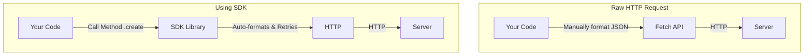

# Module: USING PRE-TRAINED MODELS AND SDKs

**Session Time:** 120 minutes

---

## Table of Contents

1. The "Model as a Service" Paradigm
2. APIs vs. SDKs: Why use a Library?
3. Implementing Language Features (OpenAI SDK)
4. Implementing Vision Features (TensorFlow.js Pre-trained Models)
5. Lab: Adding AI Sentiment Analysis
6. Wrap-Up and Reflection
7. Resources

---

## Module Overview

In this module, learners leverage pre-trained AI services and SDKs to implement language, vision, and recommendation features. Instead of training models from scratch (which requires massive data and compute), we focus on integrating "off-the-shelf" intelligence that is ready to use immediately.

---

## Learning Objectives

By the end of this module, participants will be able to:

1. **Implement AI functionality** using pre-trained SDKs and APIs to enhance web features.
2. **Differentiate** between raw API calls and SDK methods, understanding the benefits of using official libraries.
3. **Integrate** specific capabilities such as text generation (sentiment analysis) and computer vision (object detection) into an existing web codebase.

---

## Session Breakdown

| Segment | Topic | Duration (minutes) |
| --- | --- | --- |
| 1 | The "Model as a Service" Paradigm | 20 |
| 2 | APIs vs. SDKs: Why use a Library? | 20 |
| 3 | Implementing Language Features (OpenAI) | 25 |
| 4 | Implementing Vision Features (TensorFlow.js) | 25 |
| 5 | Lab: Adding AI Sentiment Analysis | 30 |

---

## 1. The "Model as a Service" Paradigm

Building a machine learning model from scratch involves data collection, cleaning, training, tuning, and deployment. "Model as a Service" (MaaS) abstracts this entire process. You simply send input to a provider, and they return the output.

### Advantages of Pre-trained Models

* **Time to Market:** Add "Computer Vision" to your app in 15 minutes instead of 6 months.
* **Performance:** Models like GPT-4 or MobileNet have been trained on datasets larger than most individual developers can access.
* **Maintenance:** The provider handles updates and scaling.

---

## 2. APIs vs. SDKs: Why use a Library?

While you *can* access AI services via raw HTTP requests (using `fetch`), most providers offer a **Software Development Kit (SDK)**.

### What is an SDK?

An SDK is a library of code (a "kit") provided by the service to help developers use their API more easily. It acts as a wrapper around the raw API calls.

### Comparison: Raw Fetch vs. OpenAI SDK

**Approach A: Raw Fetch (Harder)**

```javascript
const response = await fetch("https://api.openai.com/v1/chat/completions", {
  method: "POST",
  headers: {
    "Authorization": `Bearer ${apiKey}`,
    "Content-Type": "application/json"
  },
  body: JSON.stringify({ model: "gpt-3.5-turbo", messages: [...] })
});
// You must manually handle errors, retries, and JSON parsing.

```

**Approach B: Using the SDK (Easier)**

```javascript
import OpenAI from 'openai';
const openai = new OpenAI();

const completion = await openai.chat.completions.create({
  messages: [{ role: "user", content: "Hello" }],
  model: "gpt-3.5-turbo",
});
// The SDK handles headers, types, and connection errors for you.

```



---

## 3. Implementing Language Features (OpenAI SDK)

Language models can do more than just "chat." They are powerful text processing engines.

### Common Use Case: Sentiment Analysis

Instead of training a model to understand "angry" vs. "happy" words, we can prompt a pre-trained model to classify text for us.

**The Prompt Strategy:**
You don't just ask the AI to "read" the text; you give it specific instructions on the output format.

**Example Code:**

```javascript
async function analyzeSentiment(userComment) {
  const completion = await openai.chat.completions.create({
    messages: [
      { role: "system", content: "You are a sentiment analyzer. Reply with only one word: 'Positive', 'Negative', or 'Neutral'." },
      { role: "user", content: `Analyze this comment: "${userComment}"` }
    ],
    model: "gpt-3.5-turbo",
  });

  return completion.choices[0].message.content; 
  // Returns: "Positive"
}

```

---

## 4. Implementing Vision Features (TensorFlow.js)

For vision tasks, we often use pre-trained models that run directly in the browser (Client-side), as discussed in previous modules. However, here we focus on using high-level SDK wrappers like `coco-ssd` (Common Objects in Context), which abstracts the complex tensor math entirely.

### Object Detection Example

The `coco-ssd` SDK provides a simple `.detect()` function that returns a list of objects, their coordinates (bounding box), and confidence scores.

**Code Example:**

```javascript
// Load the SDK/Model
import * as cocoSsd from '@tensorflow-models/coco-ssd';

// 1. Initialize the pre-trained model
const model = await cocoSsd.load();

// 2. Pass an HTML Image element to the model
const predictions = await model.detect(document.getElementById('img'));

// 3. Output
console.log(predictions);
// Result: [{ class: "person", bbox: [x, y, w, h], score: 0.95 }]

```

---

## 5. Lab: Adding AI Sentiment Features

**Objective:** Add a text-generation or sentiment-analysis feature to a web app using a pre-trained model.

### Scenario

You are building a "Product Review" component. You want to automatically tag reviews as "Positive" or "Negative" so the shop owner can filter them easily.

### Step 1: Setup

* Clone the starter repository (a simple React form that accepts a review).
* Install the OpenAI SDK: `npm install openai`.
* Configure your `.env` file with your API Key.

### Step 2: Create the Analysis Action

Create a server-side function (Node.js or Next.js Server Action) that accepts the review text.

* **Prompt Engineering:** Write a system prompt that enforces strict output (e.g., "Return JSON format: { sentiment: 'Positive', confidence: 0.9 }").

### Step 3: Connect the UI

* When the user clicks "Submit Review," trigger the analysis function.
* Display a badge next to the review: Green for Positive, Red for Negative.

### Step 4: Test Edge Cases

* Try submitting sarcasm: "Oh great, my package arrived broken. Just what I wanted."
* Does the AI catch the nuance? (Likely yes, unlike simple keyword filters).

---

## 6. Wrap-Up and Reflection

**Reflection Questions:**

1. Why might you choose a **Pre-trained SDK** (like `coco-ssd`) over training your own vision model from scratch?
2. What are the risks of relying entirely on a third-party API (like OpenAI) for a core feature of your business? (Consider cost, downtime, and data privacy).

---

## 7. Resources

* [OpenAI Node.js SDK](https://github.com/openai/openai-node)
* [TensorFlow.js Models Repo](https://github.com/tensorflow/tfjs-models)
* [NPM: COCO-SSD](https://www.google.com/search?q=https://www.npmjs.com/package/%40tensorflow-models/coco-ssd)